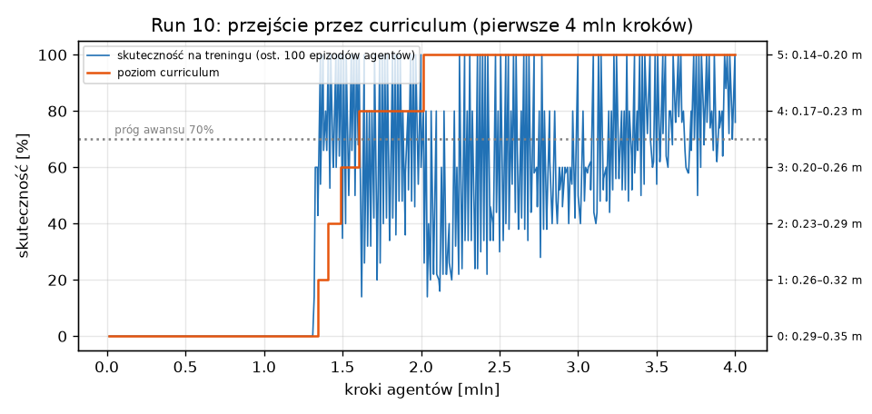
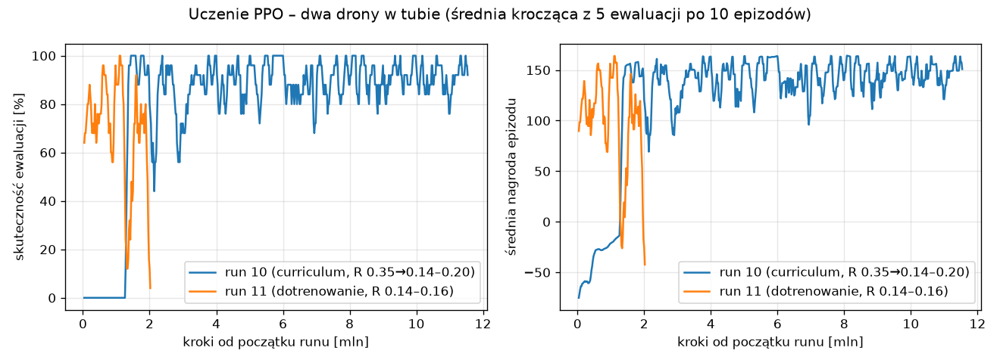
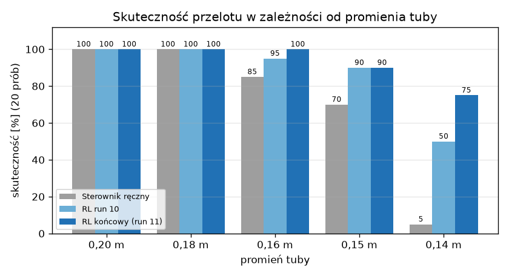

# Raport: zdecentralizowane wymijanie dwóch dronów w wąskiej tubie z użyciem uczenia ze wzmocnieniem

**Przedmiot:** RISA_2, planowanie ruchu i autonomia
**Repozytorium:** https://github.com/mikoayy/drony
**Dokumentacja techniczna i instrukcja uruchomienia:** [README.md](README.md)

---

## Spis treści

1. [Cel i sformułowanie zadania](#1-cel-i-sformułowanie-zadania)
2. [Wybór symulatora](#2-wybór-symulatora)
3. [Środowisko `TubeAviary`](#3-środowisko-tubeaviary)
4. [Percepcja: co dron „wie” i skąd](#4-percepcja-co-dron-wie-i-skąd)
5. [Akcja i sterowanie niskiego poziomu](#5-akcja-i-sterowanie-niskiego-poziomu)
6. [Funkcja nagrody](#6-funkcja-nagrody)
7. [Algorytm uczenia i sieci neuronowe](#7-algorytm-uczenia-i-sieci-neuronowe)
8. [Przebieg uczenia: 12 treningów](#8-przebieg-uczenia-12-treningów)
9. [Wyniki](#9-wyniki)
10. [Dyskusja i ograniczenia](#10-dyskusja-i-ograniczenia)
11. [Możliwe rozszerzenia](#11-możliwe-rozszerzenia)
12. [Dodatek: jak uruchomić, pliki i parametry](#12-dodatek-jak-uruchomić-pliki-i-parametry)

---

## 1. Cel i sformułowanie zadania

Dwa quadrocoptery Crazyflie 2.x startują z przeciwnych końców wąskiej, okrągłej tuby
i lecą naprzeciw siebie. Każdy ma przelecieć tubę i dolecieć do celu po drugiej stronie.
Celem projektu było nauczenie tego zachowania metodą uczenia ze wzmocnieniem (RL).

Zadanie ma trzy twarde zasady, ustalone na początku projektu:

| Zasada | Uzasadnienie |
|---|---|
| **Drony muszą minąć się wewnątrz tuby.** Minięcie przed wlotem albo za wylotem kończy epizod porażką. | Bez tej zasady najprostsza strategia to „jeden czeka przed tubą, drugi przelatuje”. Wtedy zadanie sprowadza się do ustalenia kolejności, a nie do planowania ruchu w ciasnej przestrzeni. |
| **Czekanie się nie opłaca.** Koniec czasu (15 s) jest porażką, a każdy krok kosztuje. | Zawis w miejscu to naturalne „bezpieczne” lokalne optimum dla RL i trzeba go wprost wykluczyć (patrz rozdział 8). |
| **Brak wspólnego mózgu.** Każdy dron wybiera akcję wyłącznie na podstawie własnej obserwacji. | Odpowiada to realnemu systemowi wieloagentowemu bez centralnego planisty. Drony koordynują się niejawnie, przez obserwację ruchu drugiego drona. |

### Dlaczego to jest trudne

Tuba ma promień 0,14–0,20 m, a dron do celów kolizji to walec o promieniu 6 cm.
Zderzenie dronów liczy się, gdy ich środki są bliżej niż 12 cm, a środek każdego
drona musi być co najmniej 6 cm od ścianki.

| Promień tuby R | Maks. rozsunięcie środków (2·(R − 6 cm)) | Zapas ponad 12 cm |
|---|---|---|
| 0,20 m | 28 cm | 16 cm |
| 0,18 m | 24 cm | 12 cm |
| 0,16 m | 20 cm | 8 cm |
| 0,15 m | 18 cm | 6 cm |
| **0,14 m** | **16 cm** | **4 cm** (po ok. 2 cm na stronę) |

Przy R = 0,14 m drony muszą się rozjechać prawie do samych ścianek, w odpowiednim
momencie i w przeciwne strony, nie wiedząc, co zrobi drugi. Prosta ręczna reguła
„trzymaj się prawej strony” działa przy szerokiej tubie, ale przy 0,14 m udaje się
tylko w 5% prób (rozdział 9). To właśnie obszar, w którym RL ma coś do zaoferowania.

---

## 2. Wybór symulatora

Wybrano **[`gym-pybullet-drones`](https://github.com/learnsyslab/gym-pybullet-drones)**
(fizyka PyBullet, interfejs Gymnasium):

- ma gotowy, realistyczny model Crazyflie 2.x (masa, bezwładność, ciąg silników, opór);
- obsługuje wiele dronów w jednej symulacji i opcjonalny **downwash** (strumień powietrza
  od drona lecącego wyżej, `Physics.PYB_DW`);
- ma wbudowany regulator PID (`DSLPIDControl`), więc agent może zadawać prędkość zamiast
  obrotów silników;
- współpracuje ze Stable-Baselines3 i działa na zwykłym CPU.

Rozważane alternatywy: PyFlyt (mniej materiałów), OmniDrones / Aerial Gym na Isaac Sim
(za ciężkie dla laptopowego RTX 4050 z 6 GB) i crazyflow w JAX (młody projekt, słabe
wsparcie przeszkód). Tuby w żadnym z nich nie ma, więc i tak trzeba ją było dopisać.

Konfiguracja: Python 3.12 w `venv` (przez `uv`), `pybullet` kompilowany ze źródeł,
Stable-Baselines3 2.9.0, trening na CPU (16 rdzeni).

---

## 3. Środowisko `TubeAviary`

Plik: `gym_pybullet_drones/envs/TubeAviary.py` (klasa dziedziczy po `BaseRLAviary`).

### 3.1 Scena

```
 cel D1 (x=-0,5)   start D0 (x=-0,9)    tuba x ∈ [0; 1,5]    start D1 (x=2,4)   cel D0 (x=2,0)
                       D0 o  ---->   ((==================))   <----  o D1
```

| Element | Wartość |
|---|---|
| Tuba | okrągła, długość 1,5 m, oś pozioma wzdłuż X na wysokości 1 m, ścianka 1 cm |
| Promień tuby | losowany na początku każdego epizodu z zadanego zakresu (docelowo 0,14–0,20 m) |
| Budowa tuby | 36 płaskich płytek (`GEOM_BOX`) ułożonych po obwodzie z lekką zakładką (bez szpar); obiekty statyczne (masa 0), półprzezroczyste w GUI |
| Drony | 2 × Crazyflie 2.x (`DroneModel.CF2X`), 27 g, ramię ok. 4 cm |
| Start | 0,9 m przed własnym wlotem, z losowym przesunięciem: ±0,15 m wzdłuż osi, ±0,25 m w bok, ±0,20 m w pionie; dron 1 obrócony o 180° (patrzy w stronę tuby) |
| Cel | 0,5 m za wylotem po przeciwnej stronie (w GUI czerwony i niebieski punkt) |
| Częstotliwości | fizyka 240 Hz, sterowanie (decyzje polityki) 30 Hz |
| Długość epizodu | maks. 15 s = 450 kroków decyzyjnych |

Losowanie promienia i pozycji startowych zapobiega temu, by polityka „wykuła” jeden
konkretny tor. Musi działać dla całej rodziny sytuacji.

### 3.2 Układy współrzędnych drona

Każdy dron ma własny układ współrzędnych:

- początek w środku **jego** wlotu do tuby;
- oś x' wzdłuż tuby, w stronę jego celu (postęp `u`: 0 = wlot, 1,5 = wylot, 2,0 = cel);
- dla drona 1 układ jest obrócony o 180° wokół osi pionowej (macierz `MIRROR = diag(-1, -1, 1)`).

Dzięki temu **oba drony widzą identyczne zadanie** („leć do przodu przez tubę, z naprzeciwka
nadlatuje ktoś”), więc jedna sieć może sterować każdym z nich. Zasada „trzymaj prawą”
w układzie lokalnym oznacza dla dwóch dronów przeciwne strony w świecie, czyli naturalne
wymijanie.

### 3.3 Warunki zakończenia epizodu

| Zdarzenie | Wynik | Kogo dotyczy kara |
|---|---|---|
| Oba drony ≤ 0,1 m od celu, po minięciu w tubie | **sukces** | (nagroda dla obu) |
| Dron dotyka ścianki tuby lub krawędzi wlotu | kolizja `droneX_wall` | winny dron |
| Dron dotyka ziemi lub schodzi poniżej 5 cm | kolizja `droneX_ground` | winny dron |
| Dron wylatuje poza obszar (x ∉ [−2; 3,5] m, \|y\| > 1,2 m, \|z − 1\| > 0,9 m) albo przechyla się ponad 0,8 rad | poza obszarem | winny dron |
| Środki dronów bliżej niż 12 cm albo kontakt brył | kolizja `drone_drone` | **oba** |
| Minięcie poza tubą albo wylot jednego drona z tuby, zanim minął drugiego | `pass_outside_tube` | **oba** |
| Upłynęło 15 s | koniec czasu | **oba** |

Wykrywanie kolizji robi **środowisko** (sędzia), a nie dron. Szczegóły w punkcie 4.4.

---

## 4. Percepcja: co dron „wie” i skąd

**Dron nie ma żadnych czujników: ani kamery, ani lidaru, ani czujników odległości.**
`TubeAviary` używa obserwacji kinematycznej (`ObservationType.KIN`): w każdym kroku
środowisko odczytuje z symulatora PyBullet dokładny stan obu dronów (pozycje, orientacje,
prędkości) i układa z niego wektor 24 liczb dla każdego drona. Nie ma tu pomiaru, opóźnień
ani błędów, chyba że celowo włączy się szum (`--obs_noise`).

Biblioteka `gym-pybullet-drones` ma jeszcze obraz z kamery drona (`ObservationType.RGB`),
ale w tym projekcie go nie używamy. Lidaru biblioteka nie ma wcale.

Jest to świadome uproszczenie, typowe w RL dla robotyki: uczymy **warstwę decyzyjną**
(jak lecieć, kiedy i w którą stronę się rozsunąć), zakładając, że dron zna swój stan
i stan sąsiada.

### 4.1 Wektor obserwacji (24 liczby, układ własny drona)

| Indeks | Liczby | Znaczenie | Skąd się bierze |
|---|---|---|---|
| 0–2 | 3 | pozycja względem wlotu tuby (u, y', z') | dokładna pozycja z symulatora, przeliczona do układu drona |
| 3–5 | 3 | orientacja: roll, pitch, yaw | dokładny stan z symulatora |
| 6–8 | 3 | prędkość liniowa | dokładny stan z symulatora |
| 9–11 | 3 | prędkość kątowa | dokładny stan z symulatora |
| 12–14 | 3 | **pozycja drugiego drona względem mnie** | różnica dokładnych pozycji z symulatora (opcjonalnie: szum, limit zasięgu) |
| 15–17 | 3 | **prędkość drugiego drona względem mnie** | różnica dokładnych prędkości (opcjonalnie: szum) |
| 18 | 1 | flaga „widzę drugiego drona” (1/0) | 1, gdy odległość ≤ `sensing_range` |
| 19–21 | 3 | moja poprzednia akcja | bufor akcji |
| 22 | 1 | promień tuby | parametr epizodu |
| 23 | 1 | pozostały czas epizodu (1 → 0) | licznik kroków |

Dron **nie zna** obserwacji, akcji ani nagrody drugiego drona. Zna tylko jego położenie
i prędkość.

### 4.2 Jak dron „wykrywa” drugiego drona

Nie wykrywa go żadnym czujnikiem: dostaje gotową informację, gdzie jest drugi dron.

- Pozycja i prędkość drugiego drona są podawane **względnie** (różnica „on minus ja”)
  i **w moim układzie**. Dla polityki „drugi dron jest 0,8 m przede mną i lekko w lewo,
  zbliża się z prędkością 0,9 m/s” ma zawsze ten sam zapis, niezależnie od tego,
  którym dronem jest.
- **Zasięg widzenia** (`--sensing_range`, domyślnie nieograniczony): gdy drugi dron jest
  dalej, sześć liczb o nim to zera, a flaga widoczności = 0. Flaga pozwala sieci odróżnić
  „nie widzę go” od „jest dokładnie w moim środku”.
- **Szum** (`--obs_noise σ`): do względnej pozycji dodawany jest szum gaussowski
  o odchyleniu σ, a do prędkości 2σ. Pozwala sprawdzić, czy polityka działa przy niedokładnej
  informacji.
- W treningach 1–6 zasięg wynosił 1,5 m. Okazało się to błędem projektowym: zasięg kończył się
  dokładnie na wlotach tuby (tuba też ma 1,5 m), a drony uczyły się zatrzymywać tam,
  gdzie zaczynały się widzieć (rozdział 8). Od treningu 7 zasięg jest nieograniczony.

### 4.3 Jak dron „wykrywa” ściany i krawędzie tuby

Też nie wykrywa ich czujnikiem. Dron nie „widzi” tuby, ale ma w obserwacji:

1. swoją pozycję względem wlotu tuby (u, y', z'), w układzie, którego oś x' jest osią tuby;
2. promień tuby (wejście nr 22).

Z tych dwóch informacji sieć sama „wylicza” odległość do ścianki: odległość od osi to
√(y'² + z'²), więc do ścianki zostaje R − √(y'² + z'²). Tak samo z krawędzią wlotu: przy u ≈ 0
zaczyna się tuba i dron musi wtedy być bliżej osi niż R − 6 cm. Polityka nauczyła się więc
**geometrii tuby z pozycji i promienia**, a nie reagowania na odczyt czujnika. Odpowiada to
lotowi według znanej mapy przy dokładnej lokalizacji.

### 4.4 Wykrywanie kolizji przez środowisko (sędzia)

Kolizje wykrywa środowisko w każdym kroku decyzyjnym (`_collisions()`), dwoma niezależnymi
sposobami. Wystarczy, że zadziała jeden:

| Rodzaj | Test geometryczny | Test fizyczny (PyBullet) |
|---|---|---|
| dron – ścianka / krawędź wlotu | w obszarze tuby (x ∈ [−6 cm; L + 6 cm]) odległość środka drona od osi + 6 cm ≥ R | `getContactPoints` zwraca kontakt z którąkolwiek z 36 płytek tuby |
| dron – ziemia | wysokość < 5 cm | kontakt z płaszczyzną podłoża |
| dron – dron | odległość środków < 12 cm (dwa promienie kolizji) | kontakt między bryłami obu dronów |

Test geometryczny jest celowo **ostrzejszy** niż fizyczny: traktuje drona jako walec
o promieniu 6 cm, choć sama bryła Crazyflie jest mniejsza. Dzięki temu sukces w symulacji
oznacza realny zapas, a nie „otarcie się, które fizyka akurat przepuściła”. Test geometryczny
dla obszaru tuby zaczyna się 6 cm przed wlotem, więc uderzenie w **krawędź wlotu** jest też
wykrywane, kiedy dron wlatuje pod kątem.

Minięcie dronów wykrywa `_checkCrossing()`: dron 0 startuje z mniejszym x niż dron 1,
więc moment, w którym x₀ ≥ x₁, to minięcie. Miejsce minięcia (średnia z x₀ i x₁) musi
leżeć w [0; 1,5] m. Jeśli któryś dron wyleci z tuby, zanim się minęły, oznacza to, że drugi
czekał na zewnątrz, więc to także porażka.

---

## 5. Akcja i sterowanie niskiego poziomu

**Akcja polityki (na drona, 3 liczby):** zadana prędkość `[vx, vy, vz] ∈ [−1; 1]³`
w układzie drona, skalowana przez `speed_limit` = 0,6 m/s.

Przetwarzanie (`_preprocessAction`):

1. akcja jest obcinana do [−1; 1] i zapisywana do bufora (trafia do obserwacji w następnym kroku);
2. prędkość jest przeliczana z układu drona do układu świata (`MIRROR` dla drona 1);
3. regulator **PID `DSLPIDControl`** (z biblioteki, dostrojony do Crazyflie) wylicza z zadanej
   prędkości obroty 4 silników; yaw jest utrzymywany stały.

Takie rozdzielenie, czyli **RL na poziomie planowania prędkości i PID na poziomie
stabilizacji**, ma dwie zalety: sieć nie musi uczyć się utrzymywać drona w powietrzu,
a wyuczona polityka jest bliższa temu, co można by uruchomić na prawdziwym Crazyflie
(firmware przyjmuje zadaną prędkość).

**Dlaczego nie inna akcja.** W treningach 1–8 używano wbudowanej akcji `ActionType.VEL`
z biblioteki: 4 liczby = kierunek (3) + wartość prędkości (1). Kierunek był normalizowany,
więc przy akcji bliskiej zeru szum eksploracji zmieniał się w **ruch w losowym kierunku
z niezerową prędkością**. Drony szarpały się na boki i nie potrafiły nawet wcelować w szeroką
tubę. Zmiana na bezpośrednią zadaną prędkość (szum daje tylko drobne drgania) była
przełomem: zaczął działać trening 10.

---

## 6. Funkcja nagrody

Każdy dron dostaje **własną nagrodę** w każdym kroku (`_evaluate()`). Składa się ona z trzech części.

### 6.1 Shaping potencjałowy

Zastosowano tzw. *potential-based reward shaping* (Ng i in., 1999): nagroda za krok to
`10 · (Φ(s') − Φ(s))`. Taka nagroda **nie zmienia optymalnej polityki**, a tylko przyspiesza
uczenie, bo daje sygnał w każdym kroku zamiast tylko na końcu epizodu.

Potencjał drona i:

```
Φᵢ = postęp(u)                                     u = pozycja wzdłuż tuby w układzie drona
     − 1,0 · max(0, rᵢ − r_ok)          (gdy u < L)   rᵢ = odległość od osi tuby
     − 1,0 · max(0, 0,14 − lat)/0,14 · max(0, 1 − dx/1,0)
```

| Człon | Znaczenie |
|---|---|
| postęp(u) | rośnie aż do celu (u = 2,0 m), a za celem maleje, więc przelatywanie za cel się nie opłaca |
| kara za odsunięcie od osi | działa dopiero, gdy dron jest bliżej ścianki niż `r_ok = R − 6 cm − 2 cm`. W środku tuby można swobodnie zjechać w bok (to potrzebne do wymijania), a przed wlotem kara pomaga wcelować |
| człon rozsunięcia | gdy drony są blisko wzdłuż tuby (dx < 1 m), a ich odległość w przekroju (lat, w płaszczyźnie y-z) jest mniejsza niż 14 cm, potencjał spada. Odsunięcie się w bok daje nagrodę **od razu**, a jazda czołowo – karę |

### 6.2 Nagrody i kary jednorazowe

| Składnik | Wartość | Dla kogo |
|---|---|---|
| koszt czasu | −0,05 za krok (−1,5 za sekundę) | każdy dron |
| udane minięcie w tubie | +10 | oba |
| sukces (oba u celu) | +50 | oba |
| kolizja ze ścianą / ziemią / wylot | −20 − 0,05 · (pozostałe kroki) | winny |
| zderzenie dronów / minięcie poza tubą | −20 − 0,05 · (pozostałe kroki) | oba |
| koniec czasu | −20 | oba |

### 6.3 Dlaczego takie wartości

Sprawdzono kolejność łącznych nagród (dla obu dronów razem, przy ręcznym sterowniku):

| Scenariusz | Suma nagród |
|---|---|
| udany przelot w ok. 5 s | ok. **+162** |
| zderzenie czołowe | ok. **−34** |
| zawis do końca czasu | ok. **−43** |

Najważniejsza jest relacja dwóch ostatnich: **zawis musi być gorszy od próby, nawet nieudanej.**
Inaczej agent uczy się, że najbezpieczniej jest nic nie robić. Dlatego kolizja kosztuje też
pozostały czas: rozbicie się na początku nie może być „tańsze” niż dalszy lot. Koniec czasu
jest **stanem terminalnym** (a nie ucięciem epizodu), bo pozostały czas jest w obserwacji
i agent może go przewidzieć.

---

## 7. Algorytm uczenia i sieci neuronowe

### 7.1 Algorytm: PPO w wariancie IPPO z parameter sharing

- **PPO** (Proximal Policy Optimization, Schulman i in., 2017) z biblioteki Stable-Baselines3.
  Jest to algorytm *on-policy* typu aktor–krytyk: zbiera porcję doświadczeń, kilka razy
  przechodzi po niej gradientem i ogranicza zmianę polityki przez obcięcie (clipping)
  stosunku prawdopodobieństw. Jest stabilny, dobrze działa z akcjami ciągłymi i jest
  standardem w robotyce.
- **IPPO** (Independent PPO): każdy dron to osobny agent ze swoją obserwacją i nagrodą.
  Nie ma centralnego krytyka ani komunikacji.
- **Parameter sharing:** oba drony używają **tej samej sieci** (tych samych wag).
  Trening korzysta z doświadczeń obu dronów (dwa razy więcej danych), ale **w locie każdy
  dron uruchamia sieć osobno, tylko na własnej obserwacji**. Jest to więc wykonanie
  zdecentralizowane. Dzięki symetrycznym układom współrzędnych (3.2) jedna polityka pasuje
  do obu ról.

Do połączenia z SB3 napisano adapter **`MultiAgentVecEnv`** (`gym_pybullet_drones/utils/ma_vec_env.py`).
Bierze K równoległych symulacji po 2 drony i wystawia je jako 2K niezależnych środowisk
jednoagentowych: obserwacja (24,), akcja (3,), nagroda = `info['agent_rewards'][i]`.
Rozdziela też obserwacje końcowe epizodu i statystyki Monitora na poszczególnych agentów.

### 7.2 Architektura sieci

Polityka `MlpPolicy` z SB3, w której aktor i krytyk mają **osobne** sieci (bez wspólnych warstw):

```
                       ┌── Linear(24→256) ─ tanh ─ Linear(256→256) ─ tanh ─ Linear(256→3) ──► μ (średnia akcji)
obserwacja (24) ───────┤                                                                       + log σ (3, parametr uczony)
                       └── Linear(24→256) ─ tanh ─ Linear(256→256) ─ tanh ─ Linear(256→1) ──► V(s) (wartość stanu)
```

| Element | Opis |
|---|---|
| Aktor (polityka) | MLP 24 → 256 → 256 → 3, aktywacje tanh; zwraca średnią rozkładu normalnego akcji |
| Rozkład akcji | diagonalny Gauss; log σ to 3 parametry niezależne od stanu, start −1,0 (σ ≈ 0,37); w modelu końcowym ok. −1,6/−2,3/−1,8 (σ ≈ 0,20/0,11/0,16), czyli polityka stała się bardzo pewna |
| Krytyk (funkcja wartości) | MLP 24 → 256 → 256 → 1, aktywacje tanh |
| Liczba parametrów | **145 415** razem (aktor ok. 72,7 tys., krytyk ok. 72,7 tys.) |
| Wykonanie | deterministyczne (μ, bez szumu); 1 przejście sieci na drona co 1/30 s |

Dlaczego taka sieć: obserwacja jest niskowymiarowa i „gotowa” (stan, nie obraz), więc
wystarcza zwykły MLP. 256×2 to sprawdzony rozmiar dla zadań lokomocji i sterowania.
Osobne sieci aktora i krytyka są stabilniejsze, gdy nagrody mają duży zakres (od −50 do +80
na drona).

### 7.3 Hiperparametry

| Parametr | Wartość | Uzasadnienie |
|---|---|---|
| `learning_rate` | 3·10⁻⁴ | standard dla PPO |
| `gamma` | **0,995** | horyzont efektywny ok. 200 kroków (≈ 7 s). Przy 0,99 (≈ 3 s) kara za koniec czasu po 15 s była prawie niewidoczna |
| `gae_lambda` | 0,95 | standard |
| `n_steps` | 1024 kroki na agenta na aktualizację | × 16 agentów = 16 384 próbki na aktualizację |
| `batch_size` | 2048 | 8 minibatchy na epokę |
| `n_epochs` | 10 | |
| `clip_range` | 0,2 (domyślne) | |
| `ent_coef` | **0** | bonus za entropię (przy akcji VEL) powodował chaotyczny ruch |
| `log_std_init` | **−1,0** | mniejszy szum na starcie; przy σ = 1 dron w wąskiej tubie od razu uderzał w ścianę |
| liczba symulacji | 8 (`SubprocVecEnv`, osobne procesy) = 16 agentów | |
| urządzenie | CPU | mała sieć, bottleneckiem jest fizyka, nie GPU |

### 7.4 Curriculum learning

Uczenie od razu na tubie 0,14–0,20 m nie dawało sygnału: drony prawie zawsze uderzały
w ścianę, zanim nauczyły się latać prosto. Zastosowano więc **curriculum** (`CurriculumCallback`):

- trening startuje na tubie o 0,15 m szerszej (`--curriculum_start 0.16`, zaokrąglone
  do 5 poziomów po 0,03 m);
- poziomy: 0,29–0,35 → 0,26–0,32 → 0,23–0,29 → 0,20–0,26 → 0,17–0,23 → **0,14–0,20 m**;
- awans, gdy skuteczność z ostatnich 100 epizodów agentów (ok. 50 epizodów symulacji)
  przekroczy **70%**; po awansie bufor jest czyszczony, a model danego poziomu zapisywany.

### 7.5 Ewaluacja w trakcie treningu

`EvalCallback` co ok. 20 tys. kroków uruchamia 10 epizodów agentów (= 5 epizodów symulacji,
bo każdy epizod liczy się raz dla każdego drona) z polityką deterministyczną i zapisuje
najlepszy model (`best_model.zip`). Przy tak małej próbie wynik ewaluacji mocno skacze
(wykresy w rozdziale 8), dlatego końcowe porównania zrobiono osobno, na 20 epizodach dla
każdego promienia.

**Jednostka „kroku”.** Licznik kroków SB3 liczy kroki **agentów**: jeden krok symulacji
8 środowisk = 16 kroków. Jeden krok agenta to 1/30 s lotu jednego drona.

---

## 8. Przebieg uczenia: 12 treningów

Uczenie było iteracyjne. Treningi 1–9 przerywano, gdy wykresy i podgląd pokazały, że
polityka utknęła w złym zachowaniu. Za każdym razem diagnozowano przyczynę i poprawiano
środowisko. Starych modeli nie dało się dotrenować, bo zmieniały się wejścia i wyjścia sieci
(obserwacja 24 → 25 → 24 liczby, akcja 4 → 3 liczby). Logi wszystkich treningów są
w `logs/train_run*.log`.

### 8.1 Historia problemów i poprawek

| Trening | Czas / kroki | Co zaobserwowano | Diagnoza | Poprawka |
|---|---|---|---|---|
| **1** | ok. 30 min, 3,5 mln | 0% sukcesów; drony wiszą pod wlotem do końca epizodu | czekanie było tańsze niż ryzyko zderzenia; koniec czasu był tylko ucięciem epizodu, bez kary | koniec czasu = porażka (−20 dla obu); pozostały czas dodany do obserwacji; curriculum od tuby 0,20–0,26 m |
| **2** | ok. 75 min, 4,9 mln | drony wlatują do tuby, ale zatrzymują się ok. 0,4 m przed sobą | kara za bliskość drugiego drona nauczyła **hamować** zamiast wymijać | (trening 3) nowy kształt kary za bliskość |
| **3, 4** | 30–60 min, 1,6–3,4 mln | dalej stają 0,4–0,7 m od siebie, tuż przed strefą kary | agent nauczył się omijać **karę**, a nie przeszkodę (*reward hacking*); w treningu 4 łagodniejsze curriculum od 0,29–0,35 m nic nie zmieniło | kara zastąpiona **potencjałem rozsunięcia** (nagroda za odjechanie w bok, gdy drugi jest bliżej niż 1 m); kara za zawis −40 |
| **5, 6** | ok. 20 min, ok. 1 mln | drony wiszą przy wlotach | (1) przy `gamma = 0,99` kara −40 odległa o 10 s waży ok. −2, a pobliskie zderzenie −20, więc zawis „wygląda” na tańszy; (2) zasięg widzenia 1,5 m kończy się dokładnie na wlotach | **koszt czasu w każdym kroku**; kolizja dodatkowo kosztuje pozostały czas; `gamma = 0,995`; nieograniczony zasięg widzenia |
| **7, 8** | ok. 20 min, ok. 1 mln | nawet w szerokiej tubie drony nie trafiają we wlot i szarpią się na boki | akcja „kierunek + wartość” zamieniała szum w ruch w losowym kierunku | **akcja = zadana prędkość [vx, vy, vz]**, `log_std_init = −1`, `ent_coef = 0` |
| **9** | 1,4 mln | wolniejszy postęp niż 10 (nagroda −54 vs −22 po 1 mln) | ta sama konfiguracja, inne ziarno | wyłączony, żeby przyspieszyć trening 10 |
| **10** | ok. 1,7 h, 11,6 mln | **działa** (szczegóły niżej) | | |
| **11** | ok. 20 min, ok. 2 mln | dotrenowanie na 0,14–0,16 m: poprawa przy 0,14 m z 50% do 75%, potem załamanie | | zachowany najlepszy punkt jako model końcowy |

Główny wniosek z tej części: **najtrudniejsze nie było samo wymijanie, tylko usunięcie
„bezpiecznych” lokalnych optimów.** Każda wersja nagrody, w której nieruchomość była
choć trochę tańsza od próby, kończyła się nauczeniem zawisu. Do tego dochodził
techniczny szczegół (parametryzacja akcji), który okazał się warunkiem koniecznym.

### 8.2 Trening 10: przejście przez curriculum



- Do ok. 1,3 mln kroków skuteczność wynosi 0%. Drony uczą się latać prosto, celować we wlot
  i rozsuwać się. Po ok. 1 mln kroków pojawiło się **wymijanie w tubie**, ale drony
  zatrzymywały się po minięciu, zamiast lecieć do celu.
- Od 1,34 mln kroków przychodzą pierwsze sukcesy. Potem curriculum przechodzi szybko:
  poziom 1 przy 1,34 mln, 2 przy 1,41 mln, 3 przy 1,49 mln, 4 przy 1,61 mln, a docelowy
  poziom 5 (0,14–0,20 m) przy **2,02 mln** kroków.
- Na poziomie docelowym skuteczność spada do ok. 20%, a następnie rośnie do ok. 80%
  (ok. 3,6 mln kroków).
- Najlepszy model z ewaluacji (`best_model.zip`) zapisał się przy **3,74 mln** kroków.
  Od ok. 5 mln kroków wyniki stoją w miejscu (plateau), więc trening zatrzymano ręcznie
  przy 11,6 mln kroków.

Uwaga do nazewnictwa: plik `models/run10_snapshot_9.1M.zip` to kopia `best_model.zip` zrobiona,
gdy licznik treningu wskazywał 9,1 mln kroków. Same wagi pochodzą z punktu 3,74 mln kroków.

### 8.3 Trening 11: dotrenowanie na wąskich tubach

Przy losowaniu promienia z całego zakresu 0,14–0,20 m najtrudniejsze tuby stanowią małą
część prób. Dotrenowanie startowało od modelu z treningu 10 i losowało promień tylko
z zakresu **0,14–0,16 m** (bez curriculum).

- Po ok. 0,64 mln kroków (licznik 4,38 mln) model osiągnął najlepszy wynik ewaluacji.
  To jest **model końcowy** (`models/FINAL_model.zip`).
- Po ok. 2 mln kroków dotrenowania polityka gwałtownie się załamała (skuteczność 0%).
  Takie załamania zdarzają się w PPO: jedna zbyt duża aktualizacja psuje dobrze działającą,
  bardzo „pewną” politykę (małe σ). Najlepszy model był już zapisany, więc nic nie stracono.

### 8.4 Trening 12: dotrenowanie z turbulencjami

Model końcowy nie radził sobie z podmuchami (rozdział 10). Dotrenowano go z rosnącymi turbulencjami
(`--turb_curriculum 0.01,0.02,0.03`, promień 0,14–0,20 m, `--lr 1e-4`, 5 mln kroków, ok. 50 min).
Mniejszy learning rate miał zapobiec załamaniu, jak w treningu 11, i rzeczywiście trening się nie załamał.
Poziomy 1% i 2% model przeszedł od razu, a na 3% skuteczność na treningu wzrosła z ok. 30% do ok. 60–75%.

Wynik: `models/TURB_model.zip` (model z końca treningu). Skuteczność na 20 próbach:

| Promień | Turbulencje | Model końcowy (spokojne powietrze) | **TURB_model** |
|---|---|---|---|
| 0,18 m | 0 / 2% / 3% | 100% / 95% / 65% | 100% / 100% / 95% |
| 0,16 m | 0 / 2% / 3% | 100% / 55% / 25% | 100% / 95% / 90% |
| 0,15 m | 0 / 2% / 3% | 90% / 25% / 0% | 90% / 80% / 40% |
| 0,14 m | 0 / 2% / 3% | 75% / 5% / 0% | 50% / 25% / 10% |

Model odporny na podmuchy zachowuje wynik w spokojnym powietrzu przy R ≥ 0,15 m, ale traci przy 0,14 m
(75% → 50%). To typowy kompromis: polityka odporna lata ostrożniej i dalej od granicy. Przy 3% turbulencji
i R = 0,14 m (zapas ok. 2 cm na stronę) zadanie wydaje się fizycznie bliskie niewykonalności przy tym regulatorze.
Najlepszy model według ewaluacji w trakcie treningu (`best_model.zip`) okazał się gorszy od końcowego
w spokojnym powietrzu, bo ewaluacja dawała tylko 5 przelotów i część z nich przy łatwiejszych poziomach.

### 8.5 Krzywe uczenia



Wykres pokazuje skuteczność i średnią nagrodę ewaluacji (średnia krocząca z 5 ewaluacji).
Na osi X jest liczba kroków od początku danego treningu. Widać skok w treningu 10
(około 1,3 mln), plateau z wahaniami (efekt małej próby ewaluacyjnej i losowego promienia)
i załamanie w treningu 11.

Moc obliczeniowa: ok. 1900–2000 kroków agentów/s przy jednym treningu na 16 rdzeniach
(ok. 1000/s, gdy dwa treningi dzieliły CPU).

---

## 9. Wyniki

### 9.1 Porównanie z ręcznym sterownikiem

Punkt odniesienia: ręczny, też zdecentralizowany sterownik „trzymaj się prawej strony”
(`scripted_policy` w `play_tube.py`). Każdy dron ustawia się w swoim układzie na pasie
y' = −min(R − 6 cm − 3 cm, 8 cm), na osi w pionie, i leci prosto do celu.

Test: 20 epizodów na każdy promień, ziarno 100, polityka deterministyczna.

| Promień tuby | Sterownik ręczny | RL, trening 10 | **RL, model końcowy** |
|---|---|---|---|
| 0,20 m | 100% | 100% | **100%** |
| 0,18 m | 100% | 100% | **100%** |
| 0,16 m | 85% | 95% | **100%** |
| 0,15 m | 70% | 90% | **90%** |
| 0,14 m | 5% | 50% | **75%** |



### 9.2 Charakterystyka wyuczonego zachowania

- **Czas przelotu:** ok. 5 s (ręczny sterownik ok. 6 s). RL lata bliżej limitu prędkości.
- **Miejsce minięcia:** stabilnie w połowie tuby, x ≈ 0,74–0,77 m (z 1,5 m).
- **Najmniejsza odległość dronów:** 12,6–14,7 cm przy limicie 12 cm, czyli polityka
  wykorzystuje prawie całą dostępną szerokość tuby.
- **Strategia:** drony najpierw celują w środek wlotu, a w tubie, gdy drugi dron się zbliża,
  zjeżdżają w przeciwne strony (w swoich układach lokalnych w tę samą stronę). Taka umowa
  wynika z symetrii i wspólnych wag, a nie z komunikacji.
- **Typowe porażki:** zderzenie dronów tuż przy wlocie (za późno się rozsuwają) albo, rzadziej,
  otarcie o krawędź wlotu, gdy dron wlatuje pod kątem.
- **Wcześniejsze etapy:** model z pierwszego poziomu curriculum (tuba 0,32 m) przelatywał
  9/10 razy, ale wolno (ok. 10 s). Model po 2,6 mln kroków miał przy 0,14 m 25% skuteczności,
  po 5 mln kroków 50%, a po dotrenowaniu 75%.

---

## 10. Dyskusja i ograniczenia

1. **Brak czujników, idealna informacja.** Polityka dostaje dokładny stan z symulatora
   (rozdział 4), bez kamer i lidarów. Wyniki dotyczą więc samego podejmowania decyzji,
   a nie percepcji. Wariant z szumem (`--obs_noise`) i ograniczonym zasięgiem jest
   przygotowany, ale nie był trenowany.
2. **Downwash.** Trening odbywał się bez downwashu (`Physics.PYB`). Model downwashu z biblioteki
   (`BaseAviary._downwash`, siła ∝ 1/Δz²) okazał się nieużywalny w tym zadaniu: przy dronach
   na prawie tej samej wysokości dawał siły rzędu 10–7000 N (dron waży 0,27 N). Model końcowy
   i sterownik ręczny miały z nim 0% sukcesów nawet w tubie 0,18 m. W `TubeAviary` zastąpiono
   go modelem strugi powietrza: prędkość indukowana pod wirnikami v_i = √(T / 2ρA) ≈ 4 m/s,
   struga rozszerza się w dół (promień 6,3 cm + 0,2·Δz), a prędkość maleje proporcjonalnie
   do jej promienia. Na drona pod spodem działa opór ½·ρ·C_dA·v² (C_dA = 0,01 m²).
   Daje to do ok. 0,1 N (ok. 37% ciężaru) dokładnie pod drugim dronem i praktycznie zero
   przy odległości w poziomie ≥ 12 cm. Model końcowy, choć trenowany bez downwashu, osiąga
   z poprawionym modelem 100% / 90% / 70% dla R = 0,16 / 0,15 / 0,14 m (bez downwashu
   100% / 90% / 75%). Drony mijają się obok siebie, więc downwash prawie ich nie dotyczy.
   Symulator nie ma za to wcale efektów aerodynamicznych przy ściankach tuby.
3. **Turbulencje w tubie.** W ciasnej tubie strumienie od śmigieł odbijają się od ścianek
   i zderzają przy minięciu. PyBullet nie liczy przepływu powietrza, dlatego dodano model
   zastępczy włączany flagą `--turbulence [siła]` (siła jako ułamek ciężaru drona; sama flaga = 0,02):
   - **podmuchy:** losowa siła skorelowana w czasie (proces Ornsteina-Uhlenbecka, τ = 0,3 s),
     o odchyleniu `siła × ciężar`, 4 razy słabsza poza tubą i do 2 razy silniejsza, gdy drugi
     dron jest bliżej niż 0,5 m;
   - **efekt ścianki:** przyciąganie do ścianki, rosnące od zera przy luzie 5 cm
     do `2 × siła × ciężar` przy samej ściance.

   Wielkości są założeniem, a nie pomiarem. Model końcowy nie był z tym trenowany, a wynik
   (20 prób) szybko spada:

   | Siła turbulencji | R = 0,18 m | R = 0,16 m | R = 0,14 m | Ręczny, R = 0,16 m |
   |---|---|---|---|---|
   | 0 | 100% | 100% | 75% | 85% |
   | 0,01 (1% ciężaru) | 95% | 100% | 20% | 30% |
   | 0,02 | 95% | 55% | 5% | 5% |
   | 0,05 | 30% | 0% | 0% | 0% |

   Przy zapasie 1–2 cm na stronę nawet słabe podmuchy wystarczą, żeby dron dotknął ścianki.
   Uczciwy wniosek: polityka trenowana w „spokojnym powietrzu” nie jest odporna na zakłócenia.
   Dotrenowanie z turbulencjami opisano w punkcie 8.4: model `TURB_model.zip` przy 2% turbulencji
   i R = 0,16 m ma 95% zamiast 55%.
4. **Parameter sharing i symetria.** Wspólne wagi plus odbite układy sprawiają, że drony
   „umawiają się” na stronę wymijania niejawnie. To skuteczne, ale ułatwia zadanie. Z dwiema
   osobnymi sieciami (albo z dronem innego typu naprzeciwko) koordynacja byłaby trudniejsza.
5. **Granica fizyczna.** Przy R = 0,14 m zapas wynosi ok. 2 cm na stronę, a PID ma
   skończoną precyzję śledzenia prędkości. 75% to wynik bliski tego, co pozwala obecna warstwa
   sterowania.
6. **Mała próba testowa.** 20 epizodów na promień daje przedział niepewności ok. ±10–20
   punktów procentowych. Różnice 90% vs 90% albo 95% vs 100% nie są istotne statystycznie;
   różnice przy 0,14 m (5% → 50% → 75%) już tak.
7. **Niestabilność długiego treningu PPO.** Plateau od ok. 5 mln kroków i załamanie
   w dotrenowaniu wskazują, że dalsza poprawa wymagałaby np. mniejszego learning rate
   przy dotrenowaniu, harmonogramu LR albo mniejszego `clip_range`.

---

## 11. Możliwe rozszerzenia

| Rozszerzenie | Co jest gotowe |
|---|---|
| Turbulencje w tubie (`--turbulence [siła]`) | model zastępczy w `TubeAviary._turbulence`; wytrenowany `TURB_model.zip` (8.4) |
| Downwash (`--downwash`) | przełącznik w treningu i podglądzie; poprawiony model strugi w `TubeAviary._downwash` |
| Ograniczony zasięg widzenia (`--sensing_range 1.0`) | przełącznik + flaga widoczności w obserwacji |
| Szum pomiaru drugiego drona (`--obs_noise 0.01`) | przełącznik |
| Osobne sieci dla każdego drona | wymaga zmiany `MultiAgentVecEnv` / dwóch modeli PPO |
| Pomiar odległości do ścianek zamiast znajomości geometrii | nie ma w bibliotece; trzeba by dopisać promienie (`rayTestBatch` z PyBullet) |
| Zakrzywiona tuba (łuk, S) | wymaga zmiany geometrii w `_addObstacles` i układów lokalnych |
| Centralny krytyk (MAPPO) | krytyk widzi stan obu dronów tylko w treningu, wykonanie pozostaje zdecentralizowane |

---

## 12. Dodatek: jak uruchomić, pliki i parametry

### Pliki projektu

| Plik | Rola |
|---|---|
| `gym_pybullet_drones/envs/TubeAviary.py` | środowisko: tuba, układy drona, obserwacja, akcja, nagroda, kolizje |
| `gym_pybullet_drones/utils/ma_vec_env.py` | adapter: K symulacji × 2 drony → 2K agentów dla SB3 |
| `gym_pybullet_drones/examples/learn_tube.py` | trening PPO, curriculum, ewaluacja |
| `gym_pybullet_drones/examples/play_tube.py` | podgląd GUI, ocena statystyczna, sterownik ręczny |
| `tube_project/models/FINAL_model.zip` | model końcowy (spokojne powietrze) |
| `tube_project/models/TURB_model.zip` | model dotrenowany z turbulencjami (trening 12) |
| `tube_project/models/run10_snapshot_9.1M.zip` | najlepszy model treningu 10 (wagi z 3,74 mln kroków) |
| `tube_project/logs/` | logi treningów 1–11, `evaluations.npz` treningów 10 i 11 |
| `tube_project/docs/*.png` | wykresy do raportu |

### Jak uruchomić: krok po kroku

**1. Instalacja (raz).** Potrzebny jest Python 3.12 i `gcc`, bo `pybullet` kompiluje się ze źródeł (kilka minut).

```sh
git clone https://github.com/mikoayy/drony.git
cd drony
uv venv --python 3.12              # albo: python3.12 -m venv .venv
source .venv/bin/activate          # w fish: source .venv/bin/activate.fish
uv pip install -e . tensorboard    # albo: pip install -e . tensorboard
```

**2. Aktywacja środowiska (w każdym nowym terminalu).**

Wejdź do katalogu głównego repozytorium, czyli tam, gdzie leżą `pyproject.toml` i `.venv/`:

- po `git clone` z kroku 1 to katalog `drony/`;
- na komputerze, na którym powstał projekt, to `~/Documents/RISA_2/drony/gym-pybullet-drones/`.

```sh
cd ~/Documents/RISA_2/drony/gym-pybullet-drones    # albo: cd drony (po git clone)
source .venv/bin/activate                          # fish: source .venv/bin/activate.fish
```

Wszystkie dalsze komendy uruchamia się z tego katalogu.

**3. Podgląd modelu końcowego w oknie 3D.** Otwiera się okno PyBullet. W terminalu po każdym
epizodzie pojawia się linia z wynikiem, czasem lotu, najmniejszą odległością dronów i miejscem minięcia.

```sh
python gym_pybullet_drones/examples/play_tube.py --model tube_project/models/FINAL_model.zip --radius 0.15 --episodes 5
python gym_pybullet_drones/examples/play_tube.py --model tube_project/models/FINAL_model.zip --radius 0.14 --episodes 5
```

Okno zamyka się samo po ostatnim epizodzie. Wcześniej można je przerwać przez `Ctrl+C` w terminalu.
W oknie: mysz + `Ctrl` obraca kamerę, kółko przybliża.

**4. Ocena statystyczna bez okna (tak powstała tabela z rozdziału 9).** Trwa kilkadziesiąt sekund.

```sh
for R in 0.20 0.18 0.16 0.15 0.14; do
  echo "R=$R"
  python gym_pybullet_drones/examples/play_tube.py --model tube_project/models/FINAL_model.zip \
         --radius $R --episodes 20 --gui false --seed 100 | tail -2
done
```

(W fish zamiast pętli `for … do … done` użyj `for R in 0.20 0.18 0.16 0.15 0.14; …; end`.)

**5. Sterownik ręczny do porównania.** Bez `--model` uruchamia się reguła „trzymaj prawą”:

```sh
python gym_pybullet_drones/examples/play_tube.py --radius 0.15 --episodes 5                          # z oknem
python gym_pybullet_drones/examples/play_tube.py --radius 0.14 --episodes 20 --gui false --seed 100  # statystyka
```

**6. Warianty trudniejsze (test odporności modelu).**

```sh
python gym_pybullet_drones/examples/play_tube.py --model tube_project/models/FINAL_model.zip --radius 0.15 --downwash
python gym_pybullet_drones/examples/play_tube.py --model tube_project/models/FINAL_model.zip --radius 0.15 --obs_noise 0.01
python gym_pybullet_drones/examples/play_tube.py --model tube_project/models/FINAL_model.zip --radius 0.15 --sensing_range 1.0
python gym_pybullet_drones/examples/play_tube.py --model tube_project/models/FINAL_model.zip --radius 0.16 --turbulence        # 2% ciężaru
python gym_pybullet_drones/examples/play_tube.py --model tube_project/models/FINAL_model.zip --radius 0.16 --turbulence 0.05   # mocniej
```

Model był trenowany bez tych utrudnień, więc wynik może być gorszy.

**7. Trening od zera (jak trening 10).** Trwa ok. 1,5–2 h na 16 rdzeniach. Skrypt uruchamia się
z katalogu `examples`, bo tam zapisuje wyniki:

```sh
cd gym_pybullet_drones/examples
python learn_tube.py --steps 2e7 --curriculum_start 0.16 --seed 10
```

Trening w tle, odporny na zamknięcie terminala, z logiem do pliku:

```sh
nohup python learn_tube.py --steps 2e7 --curriculum_start 0.16 --seed 10 > train.log 2>&1 &
tail -f train.log            # podgląd na żywo (Ctrl+C zamyka tylko podgląd, nie trening)
```

W logu warto śledzić `success_rate`, `ep_rew_mean` i linie `[CURRICULUM] poziom …`.
Wyniki trafiają do `gym_pybullet_drones/examples/results/tube-<data-godzina>/`:

| Plik | Co to jest |
|---|---|
| `best_model.zip` | najlepszy model według ewaluacji (zapisywany na bieżąco) |
| `level{k}_model.zip` | model w chwili awansu z poziomu k curriculum |
| `final_model.zip` | model z końca treningu |
| `evaluations.npz` | wyniki wszystkich ewaluacji (do wykresów) |

**8. Dotrenowanie na wąskich tubach (jak trening 11).** Ok. 20–30 min:

```sh
cd gym_pybullet_drones/examples
python learn_tube.py --init_model ../../tube_project/models/run10_snapshot_9.1M.zip \
       --radius_min 0.14 --radius_max 0.16 --no_curriculum --steps 3e6 --seed 11
```

**9. Podgląd własnego modelu** (podstaw katalog z kroku 7 lub 8):

```sh
python play_tube.py --model results/tube-<data-godzina>/best_model.zip --radius 0.15
```

**10. Wykresy uczenia w TensorBoard.** W drugim terminalu (z aktywnym `.venv`):

```sh
tensorboard --logdir gym_pybullet_drones/examples/results
```

Następnie otwórz w przeglądarce http://localhost:6006. Najważniejsze wykresy to `rollout/success_rate`,
`rollout/ep_rew_mean`, `eval/mean_reward`, `eval/success_rate` i `curriculum/level`.

**11. Zatrzymanie treningu działającego w tle.**

```sh
pkill -f "[l]earn_tube.py"
```

(Nawias w `[l]earn` sprawia, że `pkill` nie zabije własnej powłoki, w której wpisano komendę.)

**12. Sprawdzenie, w którym kroku zapisano model:**

```sh
python -c "from stable_baselines3 import PPO; print(PPO.load('tube_project/models/FINAL_model.zip').num_timesteps)"
```

### Parametry środowiska (`TubeAviary.__init__`)

| Parametr | Domyślnie | Opis |
|---|---|---|
| `tube_radius` | 0,18 | promień [m] albo krotka (min, max) losowana co epizod |
| `tube_length` | 1,5 | długość tuby [m] |
| `tube_height` | 1,0 | wysokość osi [m] |
| `speed_limit` | 0,6 | maks. zadawana prędkość [m/s] |
| `episode_len_sec` | 15 | długość epizodu [s] |
| `randomize_start` | True | losowe pozycje startowe |
| `sensing_range` | ∞ | zasięg widzenia drugiego drona [m] |
| `obs_noise` | 0 | σ szumu pozycji drugiego drona [m] |
| `physics` | `PYB` | `PYB_DW` = z downwashem |
| `pyb_freq` / `ctrl_freq` | 240 / 30 | częstotliwość fizyki / sterowania [Hz] |
