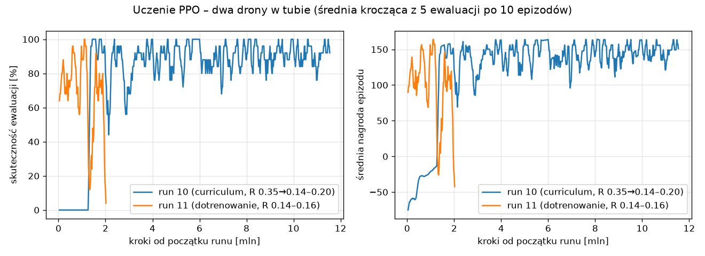

# Dwa drony w tubie: zdecentralizowane wymijanie z RL

Projekt na przedmiot RISA_2: planowanie ruchu i autonomia. Kod powstał na bazie
[`gym-pybullet-drones`](https://github.com/learnsyslab/gym-pybullet-drones).

**Zadanie.** Dwa drony Crazyflie 2.x startują z dwóch przeciwnych końców wąskiej, okrągłej tuby
i lecą naprzeciw siebie. Każdy ma dolecieć na drugą stronę. Obowiązują trzy zasady:

- drony **mijają się wewnątrz tuby**; minięcie przed wlotem albo za wylotem to porażka;
- **czekanie nie pomaga**: koniec czasu to porażka, a każda sekunda kosztuje;
- **nie ma wspólnego mózgu**: każdy dron decyduje sam, na podstawie własnej obserwacji
  (zdecentralizowane wykonanie). Wagi sieci są wspólne, ale sieć działa osobno dla każdego drona.

Tuba jest wąska: przy promieniu 0,14 m środki dronów mogą się rozsunąć najwyżej o ok. 16 cm,
a zderzenie liczy się poniżej 12 cm.



---

## Wyniki

Po 20 prób na każdy promień tuby (`--seed 100`):

| Promień tuby | Sterownik ręczny („trzymaj prawą”) | RL, run 10 (9,1 mln kroków) | **RL, model końcowy** |
|---|---|---|---|
| 0,20 m | 100% | 100% | **100%** |
| 0,18 m | 100% | 100% | **100%** |
| 0,16 m | 85% | 95% | **100%** |
| 0,15 m | 70% | 90% | **90%** |
| 0,14 m | 5% | 50% | **75%** |

- Udany przelot modelu RL trwa ok. 5 s, a sterownika ręcznego ok. 6 s.
- Drony mijają się mniej więcej w połowie tuby (x ≈ 0,75 m z 1,5 m).
- Najmniejsza odległość między dronami wynosi zwykle 12,6–14,7 cm, przy granicy kolizji 12 cm.
- Porażki modelu RL to głównie zderzenie dronów albo, rzadziej, otarcie o ściankę.

Model końcowy: [`models/FINAL_model.zip`](models/FINAL_model.zip).

---

## Instalacja

Testowane na Ubuntu z Pythonem 3.12. `pybullet` dla Pythona nowszego niż 3.10 kompiluje się
ze źródeł, więc potrzebny jest `gcc`.

```sh
git clone https://github.com/mikoayy/drony.git
cd drony

# wariant z uv (ten był używany)
uv venv --python 3.12
source .venv/bin/activate          # fish: source .venv/bin/activate.fish
uv pip install -e .
uv pip install tensorboard

# albo zwykły venv + pip
python3.12 -m venv .venv && source .venv/bin/activate
pip install -e . tensorboard
```

## Jak uruchomić

Komendy uruchamiaj z katalogu głównego repozytorium. Pakiet jest zainstalowany w trybie `-e`,
więc skrypty można też odpalać z innych miejsc.

### Podgląd wytrenowanego modelu (okno 3D)

```sh
python gym_pybullet_drones/examples/play_tube.py --model tube_project/models/FINAL_model.zip --radius 0.15 --episodes 5
```

W oknie PyBullet widać półprzezroczystą tubę, dwa drony startujące z przeciwnych końców
i punkty celu za wylotami. W terminalu wypisuje się wynik każdego epizodu.

### Ocena bez okna (statystyka)

```sh
python gym_pybullet_drones/examples/play_tube.py --model tube_project/models/FINAL_model.zip \
       --radius 0.14 --episodes 20 --gui false --seed 100
```

### Sterownik ręczny do porównania

Bez `--model` uruchamia się prosta reguła „trzymaj prawą stronę tuby”:

```sh
python gym_pybullet_drones/examples/play_tube.py --radius 0.15 --episodes 5
```

### Opcje `play_tube.py`

| Opcja | Domyślnie | Znaczenie |
|---|---|---|
| `--model` | brak | ścieżka do modelu `.zip`; bez niej działa sterownik ręczny |
| `--radius` | 0.15 | promień tuby [m] |
| `--episodes` | 3 | liczba epizodów |
| `--gui` | true | okno 3D (`true`/`false`) |
| `--seed` | 42 | ziarno losowania pozycji startowych |
| `--downwash` | wył. | fizyka z downwashem (`Physics.PYB_DW`) |
| `--sensing_range` | inf | zasięg, w jakim dron widzi drugiego [m] |
| `--obs_noise` | 0 | szum pomiaru pozycji drugiego drona [m] |
| `--lane_margin` | 0.03 | zapas od ścianki dla sterownika ręcznego [m] |

### Trening

Trening od zera z curriculum, czyli tak, jak powstał run 10:

```sh
cd gym_pybullet_drones/examples
python learn_tube.py --steps 2e7 --curriculum_start 0.16 --seed 10
```

Dotrenowanie na wąskich tubach, czyli tak, jak powstał model końcowy:

```sh
python learn_tube.py --init_model ../../tube_project/models/run10_snapshot_9.1M.zip \
       --radius_min 0.14 --radius_max 0.16 --no_curriculum --steps 3e6 --seed 11
```

Wyniki trafiają do `gym_pybullet_drones/examples/results/tube-<data>/`: `best_model.zip`,
`level{k}_model.zip` po każdym poziomie curriculum i `evaluations.npz`. Postęp można śledzić
w tensorboard:

```sh
tensorboard --logdir gym_pybullet_drones/examples/results
```

Run 10 przeszedł całe curriculum w ok. 2 mln kroków.

| Opcja `learn_tube.py` | Domyślnie | Znaczenie |
|---|---|---|
| `--radius_min`, `--radius_max` | 0.14, 0.20 | docelowy zakres losowanego promienia tuby [m] |
| `--radius` | 0.15 | stały promień, używany gdy zakres nie jest podany |
| `--steps` | 5e6 | liczba kroków treningu |
| `--n_envs` | 8 | liczba równoległych symulacji (każda daje 2 agentów) |
| `--curriculum_start` | 0.06 | o ile tuba jest szersza na pierwszym poziomie [m] |
| `--curriculum_step` | 0.03 | o ile tuba zwęża się na każdym poziomie [m] |
| `--no_curriculum` | wył. | trening od razu na docelowym zakresie |
| `--init_model` | brak | model, od którego zaczyna się trening |
| `--downwash`, `--sensing_range`, `--obs_noise` | | warianty trudniejsze (jak w `play_tube.py`) |
| `--seed` | 0 | ziarno |

---

## Co zostało zrobione: pliki

| Plik | Opis |
|---|---|
| `gym_pybullet_drones/envs/TubeAviary.py` | nowe środowisko: tuba, dwa drony, obserwacje, nagrody, kolizje |
| `gym_pybullet_drones/envs/__init__.py` | rejestracja `TubeAviary` |
| `gym_pybullet_drones/utils/ma_vec_env.py` | `MultiAgentVecEnv`: K symulacji po 2 drony daje 2K niezależnych agentów dla PPO |
| `gym_pybullet_drones/examples/learn_tube.py` | trening PPO (Stable-Baselines3) z curriculum i ewaluacją |
| `gym_pybullet_drones/examples/play_tube.py` | podgląd i ocena modelu oraz sterownik ręczny do porównania |
| `tube_project/models/` | model końcowy i punkt pośredni z run 10 |
| `tube_project/logs/` | logi wszystkich 11 treningów i wyniki ewaluacji (`evaluations.npz`) |
| `tube_project/docs/learning_curve.png` | krzywa uczenia |

## Środowisko `TubeAviary`

### Geometria

- Tuba: długość 1,5 m, oś pozioma na wysokości 1 m, ścianka 1 cm, promień losowany co epizod
  z zadanego zakresu (domyślnie 0,14–0,20 m). Zbudowana z 36 płytek po obwodzie.
- Drony: Crazyflie 2.x (`CF2X`), 27 g. Do kolizji przyjęto walec o promieniu 6 cm.
- Start: 0,9 m przed wlotem, z losowym przesunięciem (wzdłuż ±0,15 m, w bok ±0,25 m,
  w pionie ±0,2 m). Cel: 0,5 m za wylotem po drugiej stronie.
- Każdy dron ma własny układ współrzędnych: oś x wzdłuż tuby w stronę celu, początek układu
  na wlocie. Dron 1 ma układ obrócony o 180°. Dzięki temu obaj widzą zadanie identycznie
  i jedna sieć steruje każdym z nich.

### Akcja (na drona, 3 liczby)

Zadana prędkość `[vx, vy, vz] ∈ [-1, 1] × 0,6 m/s` w układzie drona. Wbudowany regulator PID
(`DSLPIDControl`) zamienia ją na obroty silników. Sterowanie: 30 Hz, fizyka: 240 Hz.

### Obserwacja (na drona, 24 liczby, we własnym układzie)

| Liczby | Zawartość |
|---|---|
| 3 | pozycja względem wlotu tuby |
| 3 | orientacja (roll, pitch, yaw) |
| 3 + 3 | prędkość liniowa i kątowa |
| 3 + 3 | względna pozycja i prędkość drugiego drona (zera, gdy jest poza zasięgiem) |
| 1 | flaga „widzę drugiego drona” |
| 3 | poprzednia akcja |
| 1 | promień tuby |
| 1 | pozostały czas epizodu |

Dron nie zna akcji ani zamiarów drugiego drona, tylko jego pozycję i prędkość.

### Nagroda (osobno dla każdego drona)

| Składnik | Wartość | Po co |
|---|---|---|
| Postęp wzdłuż tuby (shaping potencjałowy) | 10 × przyrost u | ciągnie do celu |
| Odsunięcie od osi przed i w tubie (w potencjale) | −1 × nadmiar odsunięcia | celowanie we wlot |
| Rozsunięcie, gdy drony są blisko (w potencjale) | −1 × brak rozsunięcia na boki (cel 14 cm) | uczy schodzić na bok, a nie hamować |
| Koszt czasu | −0,05 za krok | wiszenie kosztuje od razu |
| Udane minięcie w tubie | +10 dla obu | |
| Oba drony u celu | +50 dla obu | |
| Kolizja ze ścianą, z ziemią, wylot z obszaru | −20 dla winnego + koszt pozostałego czasu | |
| Zderzenie dronów albo minięcie poza tubą | −20 dla obu + koszt pozostałego czasu | |
| Koniec czasu (15 s) | −20 dla obu | |

Epizod kończy się sukcesem, kolizją albo końcem czasu.

## Uczenie

- Algorytm: PPO ze Stable-Baselines3, z parameter sharing (IPPO). Wspólne wagi uczą się
  na doświadczeniu obu dronów, ale przy wykonaniu każdy dron korzysta tylko z własnej
  obserwacji, bez komunikacji i centralnego planisty.
- Sieć: MLP 256-256 osobno dla polityki i dla funkcji wartości.
- Hiperparametry: `lr = 3e-4`, `gamma = 0.995`, `gae_lambda = 0.95`, `n_steps = 1024`,
  `batch_size = 2048`, `n_epochs = 10`, `ent_coef = 0`, `log_std_init = -1`; 8 symulacji
  równolegle, czyli 16 agentów.
- Curriculum: trening startuje na szerokiej tubie (o 0,16 m szerszej od docelowej). Tuba zwęża
  się o 0,03 m, gdy skuteczność z ostatnich epizodów przekroczy 70%.

### Historia prób: co nie działało i dlaczego

Treningi 1–9 (etapy 1–5 poniżej) zatrzymano, gdy wykres pokazał, że drony uczą się źle. Za każdym razem
po diagnozie poprawiono środowisko. To najciekawsza część projektu z punktu widzenia RL:

| Etap | Objaw | Przyczyna | Poprawka |
|---|---|---|---|
| 1 | drony wiszą przed tubą do końca epizodu | czekanie było tańsze niż ryzyko zderzenia | koniec czasu = porażka; pozostały czas w obserwacji |
| 2 | drony zatrzymują się naprzeciw siebie | kara za bliskość uczyła hamować zamiast wymijać | kara zastąpiona potencjałem nagradzającym rozsunięcie w bok |
| 3 | dalej wiszenie | przy `gamma = 0.99` kara na końcu 15-sekundowego epizodu jest prawie niewidoczna | koszt czasu w każdym kroku, `gamma = 0.995` |
| 4 | drony nie reagują na siebie przy wlocie | zasięg widzenia 1,5 m kończył się dokładnie przy wlotach | domyślnie nieograniczony zasięg |
| 5 | chaotyczny ruch na boki | akcja „kierunek + prędkość” z szumem eksploracji dawała losowy kierunek lotu | akcja = zadana prędkość, mniejszy szum startowy (`log_std_init = -1`), `ent_coef = 0` |
| run 10 | **działa**: curriculum przechodzi od tuby 0,29–0,35 m do 0,14–0,20 m w ok. 2 mln kroków | | potem plateau; zatrzymany po ok. 9 mln kroków |
| run 11 | dotrenowanie na tubach 0,14–0,16 m poprawia wynik przy 0,14 m z 50% do 75% | | po dalszym treningu polityka się załamała; zachowano najlepszy punkt jako model końcowy |

Logi każdego treningu są w `tube_project/logs/train_run*.log`.

## Ograniczenia i możliwe rozszerzenia

- Granica kolizji 12 cm daje przy R = 0,14 m tylko ok. 4 cm zapasu, stąd 25% porażek.
- Wspólne wagi sprawiają, że drony umawiają się na tę samą stronę wymijania niejawnie,
  poprzez symetrię. Wariant z osobnymi sieciami dla każdego drona byłby trudniejszy.
- Gotowe, jeszcze nietrenowane warianty trudniejsze: `--downwash`, `--sensing_range 1.0`,
  `--obs_noise 0.01`.
